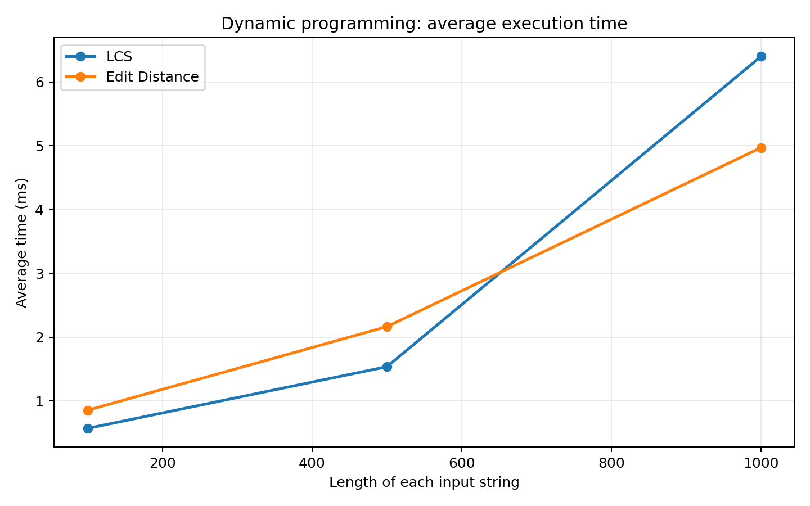
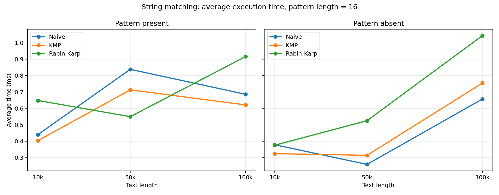

# Assignment 4—Text Analysis

## 1. Project structure and how to run

```text
Assignment_4_Text_Analysis/
├── src/
│   ├── Main.java
│   ├── TextAlgorithms.java
│   └── Experiments.java
├── test/
│   └── Tests.java
├── results/
│   └── results.csv
├── plots/
│   ├── dynamic_programming.png
│   └── string_matching.png
├── plot_results.py
├── .gitignore
└── README.md
```

run these commands from the project root:

```bash
javac -encoding UTF-8 -d out src/*.java test/*.java
java -cp out Main
java -cp out Tests
java -cp out Experiments
```

## 2. Algorithms and implementation decisions

- **LCS (Longest Common Subsequence):** returns the length of the longest subsequence shared by two strings. A subsequence need not be contiguous.
- **Edit Distance (Levenshtein):** returns the minimum number of one-character insertions, deletions, or substitutions.
- **Naive Matching:** compares the pattern with every possible starting position.
- **KMP:** uses an LPS table (longest proper prefix also equal to a suffix) to skip repeated work after a mismatch.
- **Rabin–Karp:** compares rolling hashes and checks characters whenever the hashes match, so collisions cannot produce false matches.
- **Kasai:** calculates the LCP between each neighboring pair of lexicographically sorted suffixes using a supplied suffix array and an inverse-rank array.


### Matching and Kasai correctness

KMP's LPS table records where matching can continue after a mismatch without reconsidering already matched characters. Rabin–Karp rolls the hash to the next equal-length window in constant time, but always verifies actual characters on matching hashes, avoiding false positives from collisions. Naive Matching checks each candidate position directly.

## 3. Complexity analysis


| Algorithm | Main operation | Preprocessing | Best-case time | Worst-case time | Auxiliary space | Reason |
|---|---|---|---|---|---|---|
| LCS | DP max / diagonal + 1 | None | Θ(mn) | Θ(mn) | O(mn) | Every DP cell is filled once. |
| Edit Distance | DP min of 3 edits | None | Θ(mn) | Θ(mn) | O(mn) | Every DP cell is filled once. |
| Naive | Compare characters at each offset | O(1) | O(n) | O(nm) | O(1) | A mismatch can occur immediately; each window can also require `m` comparisons. |
| KMP | LPS fallback, character comparison | O(m) | O(n + m) | O(n + m) | O(m) | The LPS table prevents rescanning text positions. |
| Rabin–Karp | Rolling hash + verify on hash match | O(m) | O(n + m) | O(nm) | O(1) | Usually constant work per window; many collisions or long genuine matches trigger costly verification. |
| Kasai | Inverse rank + shared-prefix scan | O(N) | Θ(N) | Θ(N) | O(N) | The running match length drops by at most one per suffix. |

## 4. Correctness testing

Run `java -cp out Tests`. Actual result: **ALL TESTS PASSED: 648**.

| Algorithm | Cases checked | Result |
|---|---|---|
| LCS | Identical, completely different, empty, both empty, known nontrivial answer | Passed |
| Edit Distance | Identical, empty (either side), both empty, substitution, insertion, deletion, combined edits | Passed |
| Naive, KMP, Rabin–Karp | Pattern at beginning/middle/end; overlaps; multiple matches; absent; too long; empty; empty text | Passed |
| Kasai | Manually verified `banana`, all equal, all unique, empty and single-character inputs | Passed |
| Matching cross-checks | 200 deterministic random text/pattern pairs compared to Java `indexOf` test oracle; all three algorithms must return identical lists | Passed |

## 5. Experimental results

All values below are **average execution time in milliseconds**, based on the measured CSV included in this repository.

### Dynamic programming

| String length (each) | LCS | Edit Distance |
|---:|---:|---:|
| 100 | 0.570735 | 0.854553 |
| 500 | 1.537348 | 2.165291 |
| 1,000 | 6.399674 | 4.969936 |



### String matching: pattern present

| Text length | Naive | KMP | Rabin–Karp |
|---:|---:|---:|---:|
| 10,000 | 0.440478 | 0.403624 | 0.648366 |
| 50,000 | 0.838155 | 0.713157 | 0.549686 |
| 100,000 | 0.685982 | 0.621237 | 0.916329 |

### String matching: pattern absent

| Text length | Naive | KMP | Rabin–Karp |
|---:|---:|---:|---:|
| 10,000 | 0.378692 | 0.324298 | 0.375865 |
| 50,000 | 0.259035 | 0.314363 | 0.525117 |
| 100,000 | 0.657108 | 0.754358 | 1.043519 |



A sample of recorded **character comparisons** at text length 100,000:

| Pattern | Naive | KMP (including LPS) | Rabin–Karp (verification only) |
|---|---:|---:|---:|
| Present | 133,328 | 124,534 | 16 |
| Absent | 133,095 | 124,744 | 0 |

Rabin–Karp still computes and checks hashes for each window, even when the character-comparison count is zero.

### Kasai

| String length | Average time (ms) |
|---:|---:|
| 1,000 | 0.128705 |
| 5,000 | 0.355727 |
| 10,000 | 0.909057 |

## 6. Conclusion

Use **LCS** when matching ordered subsequences, and **Edit Distance** when counting changes between strings. Both are simple and exact but use quadratic time and memory with full DP tables. **Naive** is a small baseline but can degrade to quadratic matching work. **KMP** offers a worst-case linear matching guarantee using an LPS array. **Rabin–Karp** is useful for hash-based matching but must verify collisions and has a quadratic worst case. **Kasai** computes LCP values in linear time once a sorted suffix array is available.

